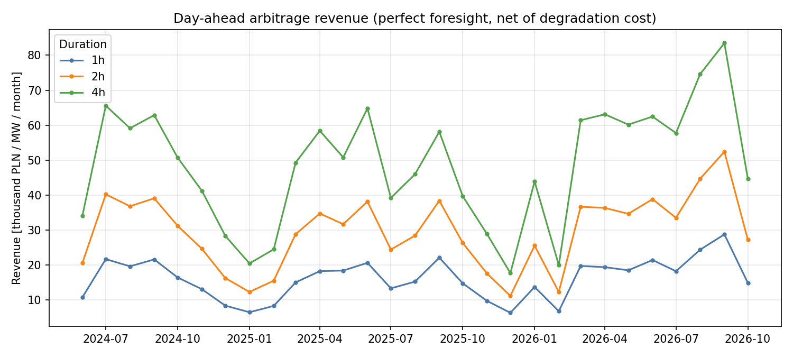
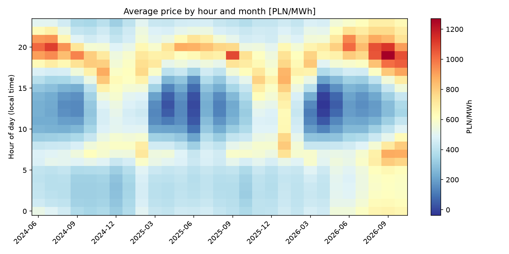
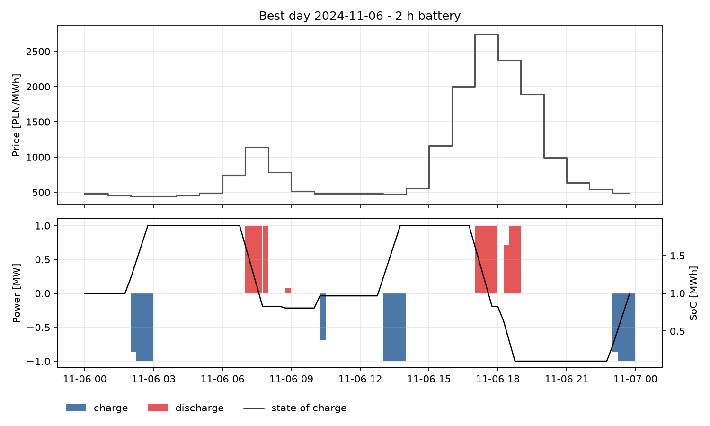

# How much can a battery earn on Polish day-ahead prices?


Backtest of battery energy storage (BESS) **price arbitrage** on Polish electricity prices, using open 15-minute
price data from the transmission system operator PSE. Every delivery day is solved as a **mixed-integer linear
program** (HiGHS via SciPy) that decides when to charge and discharge, respecting power, energy, efficiency,
state-of-charge and cycle limits. The result is an upper bound on what a battery could earn from day-ahead
arbitrage alone. The live dashboard pl-power-market-live runs this optimiser every day, and the other battery
projects of this portfolio use the same battery and reproduce its results (see [See also](#see-also)); the market
behind the spreads (negative prices, the solar "duck curve", cannibalisation) is analysed in
[pl-capture-price](https://github.com/kwwaleszczynski-del/pl-capture-price).

## Key results (14 Jun 2024 - 20 Oct 2026, 859 days)

Battery: 1 MW, round-trip efficiency 87 %, usable SoC 5-95 %, max 1.5 full cycles per day,
degradation cost 30 PLN per MWh discharged. Prices: RCE (PLN/MWh).

| Duration | Revenue, full year 2025 | Annualised, whole period | Per MWh of capacity | Avg. cycles/day |
|---|---|---|---|---|
| 1 h | 169 k PLN / MW | 198 k PLN / MW / yr | 198 k PLN / MWh / yr | 1.39 |
| 2 h | 308 k PLN / MW | 365 k PLN / MW / yr | 183 k PLN / MWh / yr | 1.37 |
| 4 h | 498 k PLN / MW | 600 k PLN / MW / yr | 150 k PLN / MWh / yr | 1.25 |

- **Longer batteries earn more per MW but less per MWh**: the extra hours capture progressively smaller spreads.
- **Revenue is rising**: by 20 October, 2026 already exceeds the whole of 2025 for every duration (2 h: 342 k against
  308 k PLN / MW). The mean daily max-min spread widened from 610 PLN/MWh in 2025 to 823 in 2026, and the gain came
  almost entirely on the selling side: the 2 h battery sold at 844 PLN/MWh on average in 2026 against 705 in 2025,
  and bought at 301 against 287 (energy-weighted, `results/rce_yearly.csv`).
- **Spreads are large and seasonal**: the average daily max-min spread is 708 PLN/MWh (median 662); prices ranged
  from -1458 to 3039 PLN/MWh.



### Sensitivity (2 h battery, annualised PLN / MW / yr)

| Round-trip efficiency | 1.0 cycle/day | 1.5 cycles/day | 2.0 cycles/day |
|---|---|---|---|
| 80 % | 301 k | 329 k | 334 k |
| 87 % | 325 k | 365 k | 377 k |
| 92 % | 340 k | 390 k | 408 k |

Efficiency matters about as much as the cycle cap: at 1.5 cycles a day, going from 80 % to 92 % adds ~19 %; at
87 %, raising the cap from 1 to 1.5 cycles a day adds ~12 % and to 2 cycles ~16 % (the extra throughput trades
smaller spreads).

### Price by hour and month

Cheap solar middays (blue) and expensive evenings (red) are what a battery trades. Negative prices and the duck
curve are analysed in [pl-capture-price](https://github.com/kwwaleszczynski-del/pl-capture-price); the run here
also draws the monthly negative-price intervals (`docs/img/negative_prices.png`).



### Best day for a 2 h battery

Two cycles: charge overnight, sell the morning peak, recharge at midday, sell the evening peak.



## Method

For each delivery day with prices `p_t` (interval length `dt` = 0.25 h) the optimiser maximises

```
sum_t p_t * dt * (discharge_t - charge_t)  -  degradation_cost * sum_t dt * discharge_t
```

subject to

- energy balance `soc_t = soc_{t-1} + eta * dt * charge_t - dt * discharge_t / eta` with `eta = sqrt(RTE)`,
- `soc_min <= soc_t <= soc_max` and `soc_end = soc_start` (no free energy carried between days),
- `0 <= charge_t <= P * u_t`, `0 <= discharge_t <= P * (1 - u_t)`, `u_t` binary - no simultaneous charging and
  discharging (with negative prices an LP would otherwise "burn" energy through losses),
- `sum_t dt * discharge_t <= max_cycles * usable_energy` - a warranty-style throughput limit.

Days with 92 or 100 intervals (daylight saving changes) are handled naturally; incomplete days are skipped.

**Data**: `rce-pln` series from the public PSE API (`https://api.raporty.pse.pl/api`), 15-minute resolution,
available from 14 June 2024. The `sdac` series (day-ahead coupling price) is also supported. Data are downloaded on
demand with [pse-opendata](https://pypi.org/project/pse-opendata/) and cached locally as monthly Parquet files (a
month is downloaded again until three days after its end); they are not part of this repository.

## Limitations

- **Perfect foresight** of day-ahead prices. Day-ahead bids are submitted before the auction and the price is its
  result, so no operator knows these prices when bidding: the numbers are an upper bound. With a price forecast made
  before the 12:00 gate, the same battery earns about 83 % of the perfect-foresight revenue in the backtest of
  [pl-bess-paper-trading](https://github.com/kwwaleszczynski-del/pl-bess-paper-trading) (SDAC prices), which also
  keeps a live track record.
- **Energy arbitrage only**: no balancing services, capacity market, ancillary services or intraday trading,
  which in practice are a large part of BESS revenue.
- **No network charges, taxes or trading fees**, and a simple linear degradation cost.
- **RCE as the price signal**: close to the day-ahead price, but not identical to an exchange settlement price.
- Prices in nominal PLN.

## Run it

```bash
pip install -e ".[dev]"
pytest -q
python -m bess_arbitrage run --series rce --start 2024-06-14 --end 2026-10-20 --durations 1 2 4
```

`python -m bess_arbitrage run --help` lists battery parameters (`--power`, `--rte`, `--cycles`, `--deg-cost`).
Results are written to `results/` (daily CSVs, summary, calendar years, sensitivity) and charts to `docs/img/`. A
full run over 859 days and 12 battery configurations takes about 4 minutes on a laptop.

```
src/bess_arbitrage/
  pse_api.py     PSE price series through pse-opendata (monthly Parquet cache)
  optimizer.py   daily MILP dispatch
  backtest.py    day-by-day backtest, annual summary, calendar years, market statistics
  plots.py       charts
  cli.py         command line interface
tests/           optimiser, backtest summary and API parser tests (no network)
```

## See also

- [pl-bess-revenue-stack](https://github.com/kwwaleszczynski-del/pl-bess-revenue-stack): the same battery selling
  arbitrage and balancing capacity (FCR, aFRR, mFRRd, RR) together, and how many megawatts the reserve markets absorb.
- [pl-bess-saturation](https://github.com/kwwaleszczynski-del/pl-bess-saturation): what a fleet of 0-10 GW of
  batteries does to the spreads it trades.
- [pl-bess-paper-trading](https://github.com/kwwaleszczynski-del/pl-bess-paper-trading): the same battery with a
  price forecast made before the gate, and a live track record.
- [pl-power-market-live](https://github.com/kwwaleszczynski-del/pl-power-market-live): daily dashboard that runs this
  optimiser on the next delivery day.

## License

MIT for the code.

**Terms of use of the data.** PSE publishes conditions for re-using public sector information
([www.pse.pl, BIP, "Ponowne wykorzystywanie informacji sektora publicznego"](https://www.pse.pl/bip/ponowne-wykorzystanie-informacji-publicznej),
entry changed on 14 October 2026, checked on 31 October 2026). They allow commercial and non-commercial re-use of
information published on www.pse.pl free of charge, on condition that the user names the source and the date the
information was obtained, removes the PSE logo, and, when the information has been processed, tells recipients that
it was changed and how, without misleading them. PSE accepts no liability for processed information and notes that
some materials may be protected by copyright or database rights. These conditions are written for www.pse.pl; this
project applies them to the reports API of the same operator. Attribution as required:

> Information obtained from www.pse.pl (PSE S.A. report `rce-pln`), state as of 30 October 2026. The information has
> been processed: used as the price signal of a battery dispatch model and aggregated to daily, monthly and annual
> statistics. It is not an official PSE publication.

The repository contains no PSE data, only derived results in `results/` and charts in `docs/img/`.
