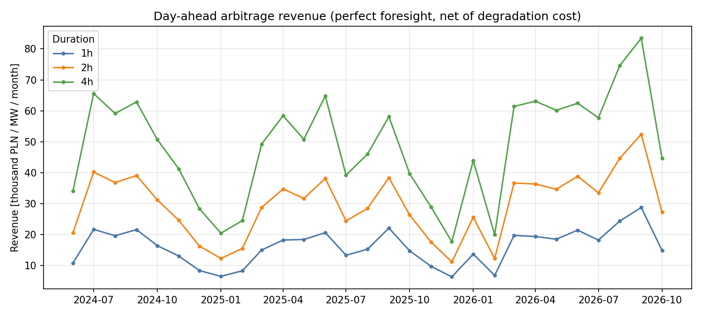
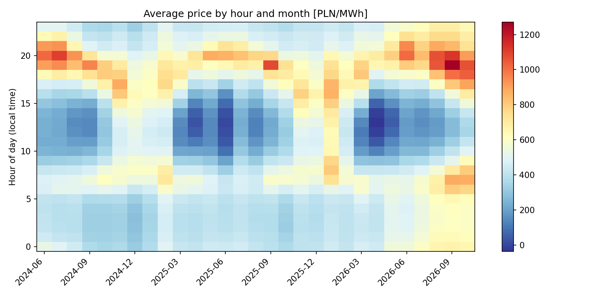
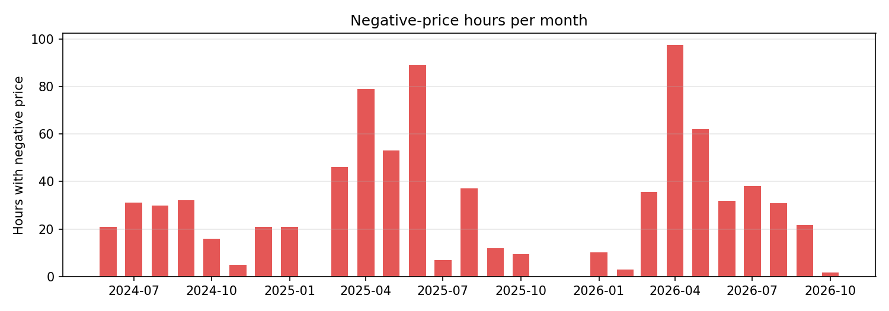
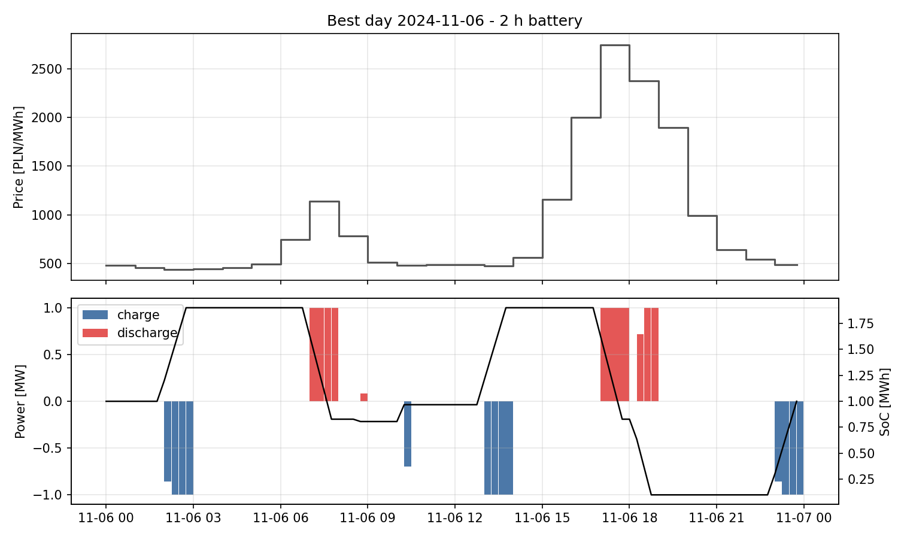

# How much can a battery earn on Polish day-ahead prices?


Backtest of battery energy storage (BESS) **price arbitrage** on Polish electricity prices, using open 15-minute
price data from the transmission system operator PSE. Every delivery day is solved as a **mixed-integer linear
program** (HiGHS via SciPy) that decides when to charge and discharge, respecting power, energy, efficiency,
state-of-charge and cycle limits. The result is an upper bound on what a battery could earn from day-ahead
arbitrage alone, plus a look at the market conditions that drive it: daily spreads, the solar "duck curve" and
negative prices.

## Key results (14 Jun 2024 - 20 Oct 2026, 859 days)

Battery: 1 MW, round-trip efficiency 87 %, usable SoC 5-95 %, max 1.5 full cycles per day,
degradation cost 30 PLN per MWh discharged. Prices: RCE (PLN/MWh).

| Duration | Revenue, full year 2025 | Annualised, whole period | Per MWh of capacity | Avg. cycles/day |
|---|---|---|---|---|
| 1 h | 169 k PLN / MW | 198 k PLN / MW / yr | 198 k PLN / MWh / yr | 1.39 |
| 2 h | 308 k PLN / MW | 365 k PLN / MW / yr | 183 k PLN / MWh / yr | 1.37 |
| 4 h | 498 k PLN / MW | 600 k PLN / MW / yr | 150 k PLN / MWh / yr | 1.25 |

- **Longer batteries earn more per MW but less per MWh**: the extra hours capture progressively smaller spreads.
- **Revenue is rising**: 2026 (to October) already exceeds full 2025 for every duration, driven by wider evening peaks.
- **Spreads are large and seasonal**: the average daily max-min spread is 708 PLN/MWh (median 662); prices ranged
  from -1458 to 3039 PLN/MWh.
- **Negative prices are now routine**: 354 hours in 2025 and 332 hours in 2026 to date (vs. 156 in H2 2024),
  concentrated around solar noon in spring.



### Sensitivity (2 h battery, annualised PLN / MW / yr)

| Round-trip efficiency | 1.0 cycle/day | 1.5 cycles/day | 2.0 cycles/day |
|---|---|---|---|
| 80 % | 301 k | 329 k | 334 k |
| 87 % | 325 k | 365 k | 377 k |
| 92 % | 340 k | 390 k | 408 k |

Efficiency matters about as much as the cycle cap: going from 80 % to 92 % adds ~19 %, allowing a second
daily cycle adds ~12 % (most days have a morning and an evening peak, but the second spread is smaller).

### The duck curve

Average price by hour of day and month: cheap solar middays (blue) and expensive evenings (red) are exactly
what a battery trades.





### Best day for a 2 h battery

Two cycles: charge overnight, sell the morning peak, recharge at midday, sell the evening peak.



## Method

For each delivery day with prices `p_t` (interval length `dt` = 0.25 h) the optimiser maximises

```
sum_t p_t * dt * (discharge_t - charge_t)  -  degradation_cost * sum_t dt * discharge_t
```

subject to

- energy balance `soc_t = soc_{t-1} + eta * dt * charge_t - dt * discharge_t / eta` with `eta = sqrt(RTE)`,
- `soc_min <= soc_t <= soc_max` and `soc_end = soc_start` (no free energy carried between days),
- `0 <= charge_t <= P * u_t`, `0 <= discharge_t <= P * (1 - u_t)`, `u_t` binary - no simultaneous charging and
  discharging (with negative prices an LP would otherwise "burn" energy through losses),
- `sum_t dt * discharge_t <= max_cycles * usable_energy` - a warranty-style throughput limit.

Days with 92 or 100 intervals (daylight saving changes) are handled naturally; incomplete days are skipped.

**Data**: `rce-pln` series from the public PSE API (`https://api.raporty.pse.pl/api`), 15-minute resolution,
available from 14 June 2024. The `sdac` series (day-ahead coupling price) is also supported. Data are downloaded on
demand and cached locally as monthly Parquet files; they are not part of this repository.

## Limitations

- **Perfect foresight** of day-ahead prices: realistic for bidding into the day-ahead market (prices are known the day
  before delivery), but a real operator also faces bidding risk, so treat the numbers as an upper bound.
- **Energy arbitrage only**: no balancing services, capacity market, ancillary services or intraday trading,
  which in practice are a large part of BESS revenue.
- **No network charges, taxes or trading fees**, and a simple linear degradation cost.
- **RCE as the price signal**: close to the day-ahead price, but not identical to an exchange settlement price.
- Prices in nominal PLN.

## Run it

```bash
pip install -e ".[dev]"
pytest -q
python -m bess_arbitrage run --series rce --start 2024-06-14 --end 2026-10-20 --durations 1 2 4
```

`python -m bess_arbitrage run --help` lists battery parameters (`--power`, `--rte`, `--cycles`, `--deg-cost`).
Results are written to `results/` (daily CSVs, summary, sensitivity) and charts to `docs/img/`. A full run over
859 days and 12 battery configurations takes about 4 minutes on a laptop.

```
src/bess_arbitrage/
  pse_api.py     PSE API client, pagination, monthly Parquet cache
  optimizer.py   daily MILP dispatch
  backtest.py    day-by-day backtest, annual summary, market statistics
  plots.py       charts
  cli.py         command line interface
tests/           optimiser and API parser tests (no network)
```

## License

MIT. Price data: PSE S.A. (public reports, raporty.pse.pl).
